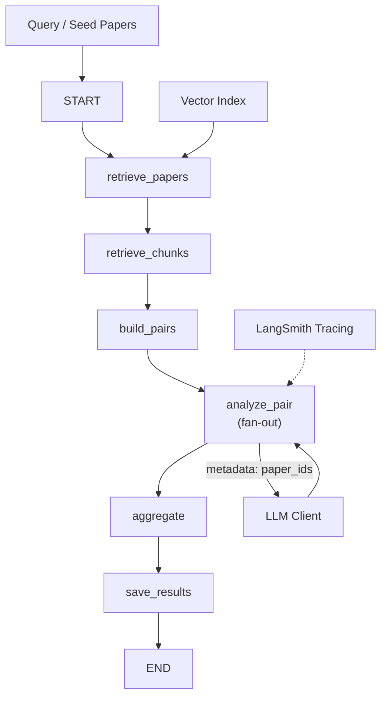

# Paper Correlation Pipeline

A system that analyzes academic papers and predicts correlations between them using Retrieval-Augmented Generation (RAG) and LLM analysis, orchestrated with LangGraph and traced with LangSmith.

## Architecture



## Pipeline Components

### Retrieval (RAG)
- **Loader** (`rag/loader.py`): Load papers from PDF/JSON
- **Chunker** (`rag/chunker.py`): Split papers into sections with token overlap
- **Embeddings** (`rag/embeddings.py`): Embed chunks using sentence transformers
- **VectorStore** (`rag/vectorstore.py`): Build and query FAISS/Chroma index
- **Retriever** (`rag/retriever.py`): Retrieve relevant papers and chunks

### LLM Analysis
- **Client** (`llm/client.py`): LLM wrapper (OpenAI, Anthropic, etc.)
- **Prompts** (`llm/prompts.py`): Pair analysis prompt template with structured output

### LangGraph Pipeline
- **State** (`graph/state.py`): GraphState with Annotated correlations reducer
- **Schemas** (`graph/schemas.py`): Pydantic models (Paper, Chunk, CorrelationResult, CorrelationMatrix)
- **Nodes** (`graph/nodes.py`):
  - `retrieve_papers`: Find relevant papers
  - `retrieve_chunks`: Extract relevant sections
  - `build_pairs`: Create candidate pairs (filtered by similarity, deduplicated)
  - `analyze_pair`: LLM analysis with structured output (fan-out via `Send`)
  - `aggregate`: Rank correlations
  - `save_results`: Write JSON/CSV output
- **Build** (`graph/build_graph.py`): Compile and expose `run_pipeline()`

### Configuration & Env
- `configs/default.yaml`: RAG/LLM/path settings
- `.env_example`: LLM API keys, LangSmith credentials

## Setup

1. **Install dependencies**:
   ```bash
   pip install -r requirements.txt
   ```

2. **Copy `.env_example` to `.env` and fill in API keys**:
   ```bash
   cp .env_example .env
   # Edit .env with your LLM provider key (OpenAI, Anthropic, etc.)
   # and LangSmith API key
   ```

3. **Place papers in `data/raw/` or `data/processed/`** (PDF or JSON format).

4. **Build vector index**:
   ```bash
   python scripts/build_index.py
   ```
   This ingests papers, embeds chunks, and saves the FAISS/Chroma index to `data/index/` or `outputs/`.

## Running the Pipeline

### Query-based correlation:
```bash
python scripts/run_graph.py --query "machine learning optimization"
```

### Seed papers (find correlations with specific papers):
```bash
python scripts/run_graph.py --paper-ids paper_1 paper_2 paper_3
```

### Output
Results are saved to `outputs/correlations_{timestamp}.json` and `outputs/correlations_{timestamp}.csv` with:
- Pairs of papers
- Correlation score (0-1)
- Relation type (same_problem, builds_on, contradicts, etc.)
- Evidence (chunk IDs, quotes)
- Explanation

## LangSmith Tracing

Every `analyze_pair` call is traced to LangSmith with:
- Metadata: paper IDs, query
- Inputs: paper titles, abstracts, relevant chunks
- Outputs: CorrelationResult

Access traces at: `https://smith.langchain.com/o/{org_id}/projects/{LANGSMITH_PROJECT}`

## Testing

```bash
pytest tests/
```

- `test_schemas.py`: Pydantic validation, deduplication, sorting
- `test_graph.py`: Graph builds, initial state

## Configuration Reference

See `configs/default.yaml`:
- `top_k`: Papers to retrieve
- `chunks_per_paper`: Chunks per paper
- `max_pairs`: Max candidate pairs
- `similarity_threshold`: Embedding cosine similarity filter
- `relation_types`: Classification labels
- `model`, `temperature`, `max_tokens`: LLM settings
- `embedding_model`: Sentence transformer model

## TODO / Implementation Checklist

- [ ] Implement `loader.py`: PDF/JSON parsing
- [ ] Implement `chunker.py`: Section detection, token chunking
- [ ] Implement `embeddings.py`: LangChain embeddings integration
- [ ] Implement `vectorstore.py`: FAISS/Chroma index
- [ ] Implement `retriever.py`: Similarity search
- [ ] Implement `client.py`: LLM calls with structured output
- [ ] Implement `nodes.py`: All graph nodes
- [ ] Implement `build_graph.py`: Graph construction and `run_pipeline()`
- [ ] Implement `build_index.py`: Full ingestion pipeline
- [ ] Implement `run_graph.py`: CLI argument handling
- [ ] Create `docs/example_output.json`: Sample correlation results
